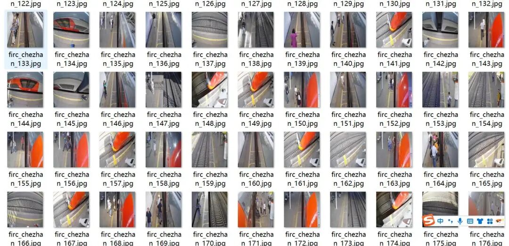
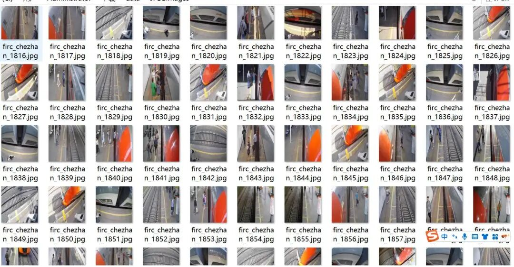
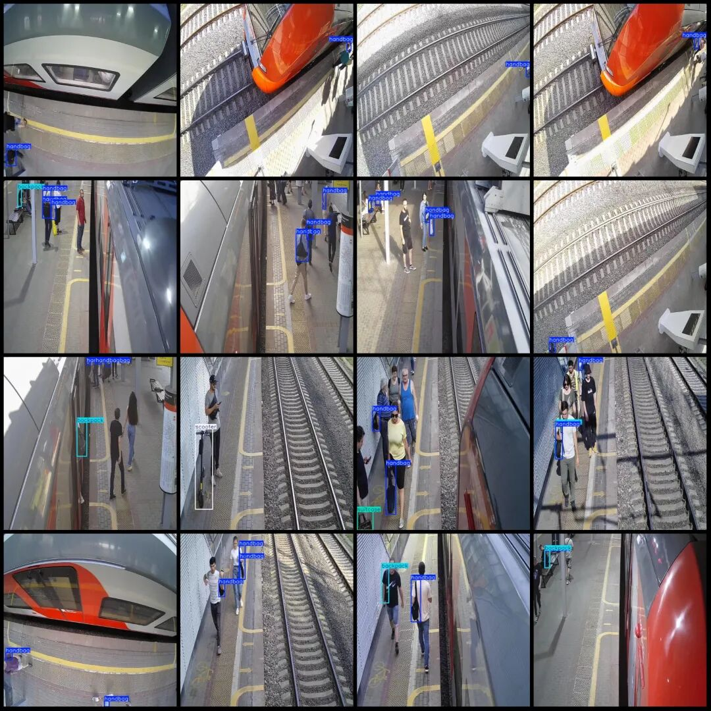

# Vehicle Inspection Data Set for Station Luggage, VOC+YOLO format with 2270 images in 6 categories

Dataset format: Pascal VOC format + YOLO format (txt file without split path, only containing jpg images and corresponding VOC format xml files and yolo format txt files)

Number of images (number of jpg files): 2270

Number of annotations (number of xml files): 2270

Number of annotations (number of txt files): 2270

Label count: 6

Label category names (note that the order of categories in the YOLO format does not correspond to this, but is based on the classes.txt file in the labels folder): ["backpack", "bicycle", "handbag", "scooter", "stroller", "suitcase"]

["Backpack", "Bicycle", "Handbag", "Scooter", "Pushchair", "Luggage"]

Number of boxes labeled in each category:

Backpack frame count = 1012

Number of bicycles = 58

Handbag frame count = 4042

Number of scooter frames = 51

Stroller frame count = 1

Suitcase frame count = 20

Total frame count: 5184

Using labelImg:

Annotation rules: Draw a rectangle around the category.

Important Notice: No

Special : This dataset does not guarantee the accuracy or precision of the trained models or weight files. The dataset is provided with accurate and reasonable annotations only.

Image Preview:

Annotation example:

## Payment

Here is a pay link on Stripe ( https://buy.stripe.com/3cs8yP7sY87d0vu9AB ). Please contact me lonlonago@foxmail.com after funding $89, and I will send you a complete data files , thank you!

